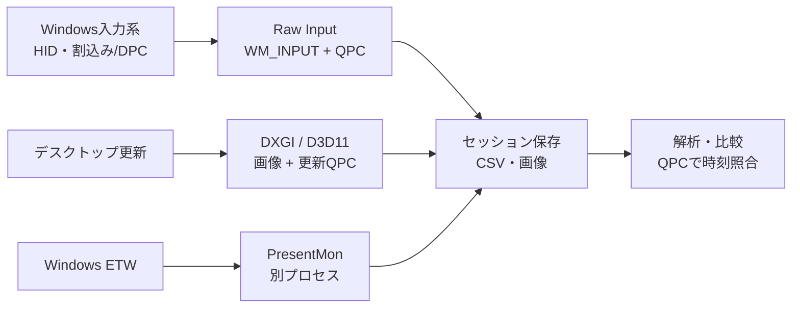

# CleanTiming

マウスのクリック受信時刻と、その前後のデスクトップ画像を記録し、**クリックから画面の変化が見えるまでの時間を調べるWindows用ツール**です。画像のコマ送り・低速再生、観測結果の保存、セッションのA/B比較に対応します。

**1.1.0-beta.1** · **Windows 11 x64** · 動作確認：Windows 11 Pro 25H2

**[ZIPをダウンロード](https://github.com/THRusT555/CleanTiming/releases/download/v1.1.0-beta.1/CleanTiming-1.1.0-beta.1-win-x64.zip)** · [リリース情報](https://github.com/THRusT555/CleanTiming/releases/tag/v1.1.0-beta.1)

## 目次

[起動](#install) · [記録](#record) · [解析](#analysis) · [操作キー](#keys) · [再生](#playback) · [A/B比較](#comparison) · [保存・出力](#save)

[内部構造](#architecture) · [結果の読み方](#results) · [動作環境](#requirements) · [エラー対処](#troubleshooting) · [変更点](#changes) · [利用条件](#license)

## 起動

1. ZIP全体を、書き込み可能なローカルフォルダーへ展開します。
2. 展開先の`CleanTiming.exe`を起動します。

`runtime`と`documents`は、展開時のフォルダー構成のまま使用します。

## 記録

1. 「セッション保存先」と「取得モニター」を選びます。
2. 「開始待ち / 記録秒数」を設定します。初期値は**開始待ち10秒・記録30秒**です。
3. 「クリック前後の画像を保存」を有効にし、画像範囲・形式を設定します。
4. Presentの補助記録を使う場合は、「公式PresentMonを補助記録」を有効にして対象プロセスを選びます。
5. 「記録を開始」または**Alt+F6**を押し、開始待ちの間に対象画面へ切り替えます。
6. 設定時間の経過、または「停止」で記録を終了します。画像の保存完了後に「QPC画像の解析」を開きます。

開始キーはAlt+F6・Ctrl+Alt+F6・無効から選択できます。Presentの対象は、記録開始時の前景プロセス、プロセス一覧、PID入力で指定します。

### 画像・保存の設定

| 設定 | 内容 |
|---|---|
| クリック前・クリック後 | 各50〜500ms。初期値は前後各50ms |
| 画像形式 | JPEG / PNG。初期値はJPEG・品質75 |
| 取得頻度 | DXGIの画像更新に追従、または上限FPSを指定 |
| 保存方式 | メモリー方式 / ストレージ方式。保持画像のRAM上限を設定可能 |
| 保存先 | セッションと一時画像の場所を指定可能 |
| 軽量設定 | 60fps上限・JPEG品質60・Present補助なし |

画像範囲・取得頻度・画像形式は、必要なメモリーと保存容量に影響します。軽量設定では画像の間隔が広がり、結果の観測区間も粗くなります。

## 解析

1. 「QPC画像の解析」で、保存が完了した1回分の記録フォルダーを選びます。
2. 調べるクリックを選び、画像を前後に送って、対象の変化が初めて見える画像を探します。
3. その画像で「画面変化開始」（**F**）を押します。死亡表示を記録するときは、該当画像で「敵の死亡」（**G**）を押します。
4. 観測対象、比較ラベル、メモ、命中結果を入力します。
5. 「確定して次へ」（**Space**）で保存し、次のクリックへ進みます。除外するクリックは**X**で次へ進めます。

任意イベントのマーカーでは、射撃描画・弾道・命中表示などを別々に指定できます。クリック番号・時刻での検索と、確認状況による絞り込みにも対応します。

### 操作キー

| キー・操作 | 動作 |
|---|---|
| A / D | 前後の画像へ移動。Shift併用で5枚ずつ |
| Q / E | 前後のクリックへ移動 |
| C | クリック受信直前の画像へ移動 |
| F | 画面変化の初確認画像を指定 |
| G | 死亡表示の初確認画像を指定 |
| Space | 確定して次のクリックへ移動 |
| X / U | 除外して次へ / 除外の取り消し |
| R | 指定を解除 |
| V | 次の未確認クリックへ移動 |
| Z | 画像表示を100%へ戻す |
| 画像上のホイール | ポインター位置を中心に拡大・縮小 |
| 拡大中のドラッグ | 表示位置を移動 |
| 画像スライダー上のホイール | 1枚ずつ移動。Shift併用で5枚ずつ |

「画像をコピー」で選択画像をクリップボードへコピーし、「画像をエクスプローラーで表示」で保存先を開けます。

### 再生

再生倍率は**0.0001〜4倍の数値入力**です。取得画像の時刻、PresentMonの提出時刻、OS表示時刻、均等コマから再生の基準を選びます。

## A/B比較

「セッションA/B比較」から、画像と確定結果を比較します。

### 画像比較

1. AとBそれぞれの記録フォルダーを選びます。
2. クリックまたはマーカーを基準イベントとして選び、時刻0を揃えます。
3. 再生・コマ送りで同じ経過時刻の画像を照合します。各画像範囲の先頭を基準とした、同じ画像番号での照合も選べます。

### 数値比較

確定した観測結果から、条件A・Bの画面変化開始や死亡確認までの平均区間・差を比較します。観測JSONを複数読み込むこともできます。集計対象は確定済みの観測です。

比較結果は「比較JSONを保存」で書き出します。

## 保存・出力

| 保存先 | 内容 |
|---|---|
| `sessions` | セッション記録。保存先は変更可能 |
| `data/preferences.json` | 設定 |
| `data/reviews` | 解析下書き・作業状態 |
| `data/temporary` | 一時画像。保存先は変更可能 |
| `data/logs/errors.jsonl` | エラー記録 |

「観測・作業JSONを保存」で、観測・マーカー・作業状態を書き出します。再開時は元の記録フォルダーを開き、「作業JSONを再開」から読み込みます。

「記録品質・診断を出力」から、診断JSONと時系列CSVを書き出せます。

## 内部構造

### 入力：割込みからRaw Inputへ

マウス入力はWindowsのドライバー・HID入力系を経て、[Raw Input](https://learn.microsoft.com/en-us/windows/win32/inputdev/about-raw-input)として配信されます。ハードウェア割込みの[ISRと後続のDPC](https://learn.microsoft.com/en-us/windows-hardware/drivers/kernel/writing-an-isr)はWindows側で処理され、CleanTimingはユーザーモードの専用スレッドで受信します。

`RegisterRawInputDevices`でマウスを登録し、`WM_INPUT`の処理入口で`Stopwatch.GetTimestamp()`によりQPCを採時します。その後`GetRawInputData`で入力内容を読み、`input.csv`へ渡します。左ボタン押下の時刻を、保存する画像範囲の基準に使います。

測定の開始点はこの`WM_INPUT`受信時刻です。割込み発生から受信までの時間は測定区間の手前にあります。

### 画像：DXGIからGPU読出しへ

画像取得スレッドがDesktop Duplicationの`AcquireNextFrame`でデスクトップ画像を受け取ります。画像の時刻には、WindowsがQPCで記録した[`LastPresentTime`](https://learn.microsoft.com/en-us/windows/win32/api/dxgi1_2/ns-dxgi1_2-dxgi_outdupl_frame_info)を使用します。

D3D11の`CopyResource`で3枠のステージングテクスチャへコピーを発行し、`Map(DO_NOT_WAIT)`で読出し可能な画像を順にCPU側へ回収します。処理が進まない間は、`CreateWaitableTimerExW`で作成した専用の高分解能タイマーで待機します。

読み出した画像は更新QPCを保持したまま、クリック前後の設定範囲に従って選別し、JPEG / PNGと`frames.csv`へ保存します。取得全体の画像時刻は`capture.csv`に記録します。CPU読出し完了時刻と、画像が更新された時刻は別の値です。

### Present：ETWによる補助記録

同梱のPresentMonを別プロセスで起動し、指定PIDのETW表示イベントを`present.csv`へ記録します。解析ではPresent提出・OS表示・取得画像を独立した系列として扱い、QPCで時刻を照合します。

## 結果の読み方

結果は、**変化がまだ見えない直前の画像と、初めて見えた画像の間の区間**です。クリック受信から8msの画像に変化がなく、12msの画像で初めて見えた場合、観測区間は8〜12msになります。

開始点は`WM_INPUT`受信時のQPC、画像側の時刻はDXGIの`LastPresentTime`です。画像間隔が時間分解能を決めます。グラフの色は、同じ記録内の平均・標準偏差に対する相対差です。

## 動作環境

| 項目 | 条件 |
|---|---|
| OS・CPU | Windows 11の正式版・x64 |
| 動作確認環境 | Windows 11 Pro 25H2 x64（26200.9711） |
| 画像取得 | 既定のD3D11 GPUに接続した、SDR・回転なしのモニター |

起動判定はWindowsのビルド・エディション・サポート期限に基づきます。2026年10月26日時点の対象は以下のとおりです。

| エディション | 対応版 |
|---|---|
| Home / Pro系 | 25H2・26H1・26H2 |
| Enterprise / Education系 | 23H2・24H2・25H2・26H1・26H2 |
| Enterprise LTSC 2024 | 24H2 |

本体は未署名ベータです。アンチチートの公認は得ていません。

## エラー対処

| 症状・コード | 対処 |
|---|---|
| 起動できない | ZIP全体を展開し、`runtime`を含む構成を確認 |
| CT1001 | 対応するWindowsの版とPCの日付を確認 |
| CT1301 / CT1302 | 保存先の空き容量、画像範囲、RAM上限、取得頻度を確認 |
| CT1501 | Presentの補助記録を確認。クリック・画像の基本記録は継続 |
| その他 | 「エラー詳細」のコードと、ZIP内の`documents/SUPPORT.md`を参照 |

## 変更点

1.1.0-beta.1では、画像のオフライン再生、A/B比較、0.0001〜4倍の再生倍率、Present提出・OS表示の再生系列、クリック前後それぞれ50〜500msの画像範囲設定を追加しました。

詳細は[リリース情報](https://github.com/THRusT555/CleanTiming/releases/tag/v1.1.0-beta.1)、検証結果はZIP内の`TEST-RESULTS.json`にあります。

## 利用条件

無料で利用できます。利用条件は[LICENSE.txt](LICENSE.txt)、第三者ソフトウェアの通知はZIP内の`documents/THIRD-PARTY.md`を参照してください。
