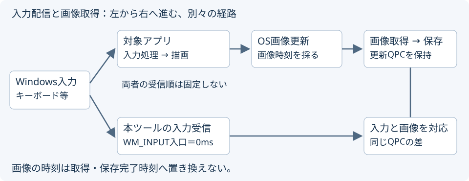
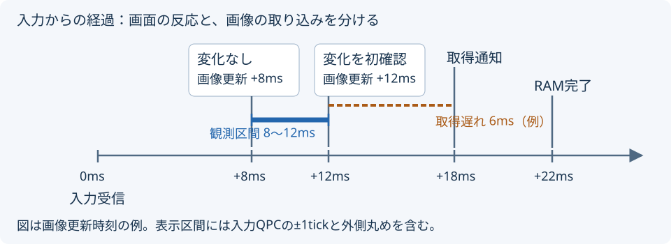
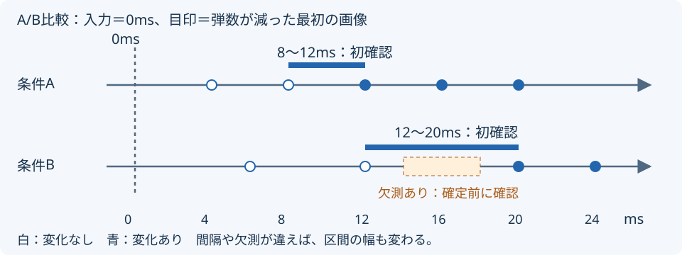

> 未署名・アンチチート互換未保証です。必ず自己責任でご使用ください。
>
> 当ツールはシステムの正確な遅延時間を保証するものではありません。

# CleanTiming

**入力後の画面変化を画像で確認し、設定変更前後の反応を比べるWindows用ツール。**

| ・ソフト概要 | ・使い方 | ・できること |
|---|---|---|
| [目的と基準](#overview) | [記録から比較まで](#usage) | [記録・解析・共有](#features) |
| [・入力と画像の仕組み](#architecture) | [・詳細挙動・結果の見方](#details) | [・動作環境・配布情報](#distribution) |

## ・ソフト概要

基準：本ツールの入力受信を0msに揃え、変化を挟む2枚の画像から反応の観測区間を求めます。

| 比べるもの | 例・意味 |
|---|---|
| 画面の変化 | 弾数減少、反動開始、命中・死亡表示など、同じ目印 |
| 反応の観測区間 | 入力受信から、変化を挟む画像更新までの範囲 |
| 記録側の遅れ | 画像更新から、取得通知・RAM読出し完了まで |

反応が変わったのか、記録側の取り込みがばらついたのかを分けて確認できます。

## ・使い方

1. [配布ZIP](https://github.com/THRusT555/CleanTiming/releases/download/1.1.3/CleanTiming-1.1.3-win-x64.zip)全体をローカルフォルダーへ展開し、`CleanTiming.exe`を起動
2. 保存先・モニター・記録する入力・入力前後の画像範囲を設定
3. 記録を開始し、開始待ちの間に対象画面へ切替 → 操作を実行 → 記録を停止
4. 保存完了後に解析を開き、対象入力の画像をコマ送りで確認
5. 変化が初めて見える画像を指定し、直前画像も確認して確定
6. 条件を変えて同じ目印を記録し、A/B比較へ読み込み

展開先：書き込み可能な場所。`runtime`・`documents`の配置を維持。

## ・できること

| 用途 | 内容 |
|---|---|
| 必要な入力を記録 | キーボードとマウス5ボタンから複数選択。入力時刻と周辺画像を対応づけ |
| 変化を探す | サムネイル一覧、画像送り・拡大・低速再生で初確認位置を選択 |
| 反応を比べる | A/Bの入力またはマーカーを0msに揃え、画像・観測区間・記録品質を照合 |
| 作業を続ける | 解析下書きの自動保存、作業JSONの書き出し・再読込 |
| 結果を共有 | 観測JSON・比較JSON、診断JSON・時系列CSVを出力 |
| 未完了記録を回収 | 残っている入力・画像から別フォルダーへ復旧。復旧後の欠測も確認 |

## ・入力と画像の仕組み

| 採時位置 | 保持する時刻 |
|---|---|
| 本ツールの入力処理入口 | `WM_INPUT`受信時のQPC。各入力の0ms |
| OSの画像更新 | `LastPresentTime`のQPC。画像が表す更新時刻 |
| 取得・読出し | 取得通知・RAM完了のQPC。取り込み側の経過 |

対象アプリと本ツールへの入力配信は別経路で、受信順は固定しません。画像の時刻は取得・保存完了時刻へ置き換えず、元の更新時刻と入力受信時刻の差から「入力の何ms後か」を求めます。

## ・詳細挙動・結果の見方

### ・観測区間と記録側の遅れ

| 例 | 読み方 |
|---|---|
| +8ms：変化なし／+12ms：初確認 | 変化を挟む範囲：約8～12ms |
| QPC 10MHzでの表示例 | 入力QPCの±1tickを含め、0.1ms単位で外側へ丸めて7.9～12.1ms |
| 初確認画像の直前がない | 下限を作らず、上限のみ |
| 画像更新→取得通知／RAM完了 | 本ツールが画像を取り込むまでの経過。反応の区間とは別 |
| 欠測・取得失敗 | 変化なしや0msとは区別。対象区間・理由を確認 |

直前画像に同じ変化がないことを目視で確かめます。Present提出・OS表示は独立系列で、近い時刻の取得画像と同じフレームとは判断しません。

### ・A/Bを揃える

| 揃える条件 | 確認するもの |
|---|---|
| 入力または同じマーカーを0msへ | 同じ経過時刻の画像と、反応を挟む区間 |
| 同じ観測目印 | 弾数減少など、初確認とする変化の定義 |
| 同じ画像取得設定 | 画像間隔・区間の幅・欠測の有無 |

区間が狭くなったことと、反応そのものが早まったことは分けて判断します。

### ・記録条件と保存

| 項目 | 値・挙動 |
|---|---|
| 開始待ち／記録時間 | 初期値：10秒／30秒。手動停止も選択可能 |
| 入力周辺の画像 | 前後各50～500ms。初期値：前後各50ms |
| 取得・画質 | DXGI更新に追従／上限FPS。JPEG／PNG。初期値：JPEG品質75 |
| 画像の保持 | メモリー／ストレージ。確定保存後に一時画像を回収 |
| 容量の扱い | RAM・一時領域に上限。保存障害時は欠測と理由を残し、再試行 |
| 連続した入力 | 各入力時刻を保持。重なる範囲は共通画像を参照し、重複処理を抑制 |
| 長い記録 | CSVを自動分割。解析では区間と境界の前後画像を選択 |
| 再生 | 0.0001～4倍。取得画像／Present提出／OS表示／均等コマ |
| 画像・Present補助 | 個別ON／OFF。画像OFFでも入力を記録 |
| 共有JSON | 旧形式を読込可能。1.1.2形式は1.1.2以降。内部の一時保存パスは除外 |

開始・停止操作と記録する入力は別設定です。長押しのリピート・解除を新しい押下として数えません。

### ・結果を読むときの確認

| 表示・状態 | 確認先 |
|---|---|
| 広い観測区間 | 直前画像、周辺の画像更新間隔、取得・保存の欠測 |
| グラフの色 | 記録内の平均・標準偏差に対する相対差。正常・異常の断定ではない |
| 保存画像がない | 画像OFF／入力0件／取得・保存失敗の状態 |
| 未完了記録 | 復旧先の結果と欠測。元の記録を上書きしない |
| 保護された画像内容 | 表示アプリを見直す。発生源と全アプリへの適合は未確認 |
| エラー | 本体のエラー詳細／ZIP内の`documents/SUPPORT.md` |

## ・動作環境・配布情報

| 項目 | 条件・案内 |
|---|---|
| 配布版 | [1.1.3・リリース情報](https://github.com/THRusT555/CleanTiming/releases/tag/1.1.3) |
| OS | Windows 11 x64。Home／Pro系：25H2・26H1・26H2 |
| 動作確認 | Windows 11 Pro 25H2 x64（26200.9711）。他エディションは`documents/SUPPORT.md` |
| 画面 | D3D11対応GPUに接続したSDR・回転なしのモニター |
| 検証範囲 | ZIP内の`TEST-RESULTS.json`。別PC・GPU・実ゲームの全条件を保証しない |
| 測定範囲 | 本ツールの入力受信後。物理スイッチ、アプリ内部の入力採用、発光時刻は含まない |
| 料金・利用条件 | 無料。[LICENSE.txt](LICENSE.txt) |
| 第三者ライセンス | ZIP内の`documents/THIRD-PARTY.md` |
